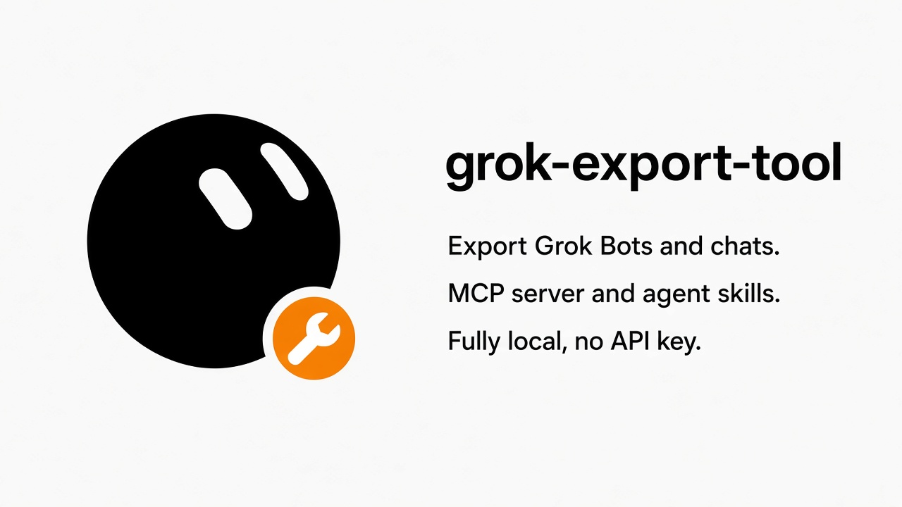

[English](README.md) · [中文](README.zh-CN.md)



# grok-export-tool

Export your **Grok Bots** and your **regular chats**. A local CLI, a stdio MCP server, and agent skills. Fully local, no API key.

It backs up the [grok.com](https://grok.com) account already signed in on this machine. Every Bot is saved with its roster, transcript, and attachments. Regular chats land in a second folder. People can read the archive, and so can agents: a small MCP server and an Agent Skill let [OpenCode](https://opencode.ai), Claude Code, Codex, and others query the Bot archive.

It reads history you already have. It does not send new chats.

[Features](#features) · [Quick start](#quick-start) · [Tutorial](#tutorial) · [MCP](#mcp) · [Agent skills](#agent-skills) · [Output](#output-layout) · [Contact](#contact) · [Donate](#donate)

## Features

- **CLI.** `grok-bot-export.py` exports Bots, regular chats, or both (`--mode bot`, `--mode chat`, `--mode all`). `--messages-only` skips Bot attachment downloads.
- **Grok Bots.** Roster, full transcript, and attachments (images, video, and other files), in parallel 4 MB chunks.
- **Regular chats.** A second folder: Markdown and raw JSON per conversation, plus one combined JSONL file.
- **Archive.** Normalized JSONL, readable Markdown, and raw JSON, with an index.
- **MCP.** A stdio server with no third-party dependencies: `list_bots`, `get_bot`, `search`. It reads the Bot archive.
- **Skills.** `.claude/skills/grok-export/` is an Agent Skill for Claude Code, OpenCode, and other agents that load that folder.

Bot history goes over grok.com’s bot WebSocket. Regular chats go over grok.com’s app-chat HTTP API, which can respond with HTTP 429; those requests are retried. The MCP server does not index a chat export. Open those files yourself, or point an agent at the folder.

## Quick start

```bash
git clone https://github.com/LofiSu/grok-export-tool.git
cd grok-export-tool
python3 -m venv .venv
source .venv/bin/activate
python3 -m pip install -r requirements.txt
```

Python 3.9 or newer. Dependencies are `websocket-client` and `cryptography` ([requirements.txt](requirements.txt)). On Windows, automatic cookie decryption also needs `pywin32`. The MCP server uses the standard library only.

```bash
python3 grok-bot-export.py                  # Grok Bots, messages and attachments
python3 grok-bot-export.py --messages-only  # Grok Bots, text only
python3 grok-bot-export.py --mode chat      # regular Grok chats
python3 grok-bot-export.py --mode all       # both
```

The same three entry points exist as `./export.sh`, `./export-messages.sh`, and `./export-chat.sh`.

| Platform | Cookie login |
| --- | --- |
| macOS | Keychain item **Chrome Safe Storage**. Profiles scanned: Default, Profile 1, Profile 2. |
| Windows | DPAPI when `pywin32` is installed. App-Bound Encryption needs `--cookie`. |
| Linux | Best effort. If that fails, use `--cookie`. |

```bash
python3 grok-bot-export.py --cookie "sso=...; sso-rw=..."
```

Copy `sso` and `sso-rw` from your own browser’s DevTools. Do not paste those values into an issue, a chat, or git.

Progress lines are in Chinese. Output lands in `~/Downloads/` unless you pass a directory.

Step-by-step help is in the [tutorial](#tutorial).

## Tutorial

The same guide, in both languages, on the site and in the repo. It covers install, each mode, the archive, MCP, skills, and the failures that actually happen.

- **Site:** [lofisu.github.io/grok-export-tool](https://lofisu.github.io/grok-export-tool/) · [中文首页](https://lofisu.github.io/grok-export-tool/index.zh-CN.html)
- **English:** [docs/guide.md](docs/guide.md) · [on the site](https://lofisu.github.io/grok-export-tool/guide.html)
- **中文:** [docs/guide.zh-CN.md](docs/guide.zh-CN.md) · [网站上的教程](https://lofisu.github.io/grok-export-tool/guide.zh-CN.html)

## MCP

`grok-bot-mcp.py` speaks MCP over stdio. Give it the **Bot** export directory. If you omit the path, it picks the newest `~/Downloads/grok-bot-export-*` folder. It does not open a network connection.

OpenCode’s current config schema puts servers under `mcp.servers`. In `~/.config/opencode/opencode.json` (or a project `opencode.json`):

```jsonc
{
  "$schema": "https://opencode.ai/config.json",
  "mcp": {
    "servers": {
      "grok-bot": {
        "type": "local",
        "command": [
          "python3",
          "/absolute/path/grok-bot-mcp.py",
          "/absolute/path/grok-bot-export-YYYYMMDD"
        ]
      }
    }
  }
}
```

| Tool | Role |
| --- | --- |
| `list_bots` | Names, ids, message counts, last active time |
| `get_bot` | One bot, by name, id fragment, or folder prefix such as `01`. `limit` defaults to 200 |
| `search` | Case-sensitive substring on message text, with neighboring lines. `context` defaults to 2 |

Claude Code, Codex, and Cursor launch the same process from their own config files. Paths and examples are in the [guide](docs/guide.md#6-mcp-server-for-opencode).

## Agent skills

The skill lives at `.claude/skills/grok-export/SKILL.md`.

- **Claude Code** reads `.claude/skills/` in the project.
- **OpenCode** reads that folder too, or you can set `"skills": [".claude/skills"]`.
- **Codex, Copilot, Gemini CLI, Cursor** — copy `grok-export/` into the skills directory that agent documents.

The skill name is **grok-export**. Ask in ordinary language to export, or to look something up in the Bot archive.

## Output layout

Grok Bots (default, or the Bot half of `--mode all`):

```
~/Downloads/grok-bot-export-YYYYMMDD/
  AGENTS.md
  _index.md
  roster.json
  01_<bot name>/
    meta.json
    transcript.json
    messages.jsonl
    conversation.md
    attachments/
```

`messages.jsonl` is one JSON object per line. Fields you can rely on: `seq`, `type` (`message`, `send-message`, `user-attachment`, `event`, `voice-call`), `role` (`user` or `assistant` when the entry has one), `content`, `timestamp`, `timestampMs`, `attachment`, `localFile`, `event`, `call`.

Regular chats (`--mode chat`, or the chat half of `--mode all`):

```
~/Downloads/grok-chat-export-YYYYMMDD/
  _index.md
  conversations.jsonl
  conversations/
    0001_<title>.md
    0001_<title>.json
```

`conversations.jsonl` fields: `conversationId`, `title`, `role`, `sender`, `content`, `timestamp`, `timestampMs`. Chat export records response text and the raw response JSON. It does not download attachment files.

Pass a directory to override the default. With `--mode all` and a directory, Bots go to that directory and chats go to the same path with `-chat` appended. The process uses umask 077 and then marks directories `0700` and files `0600`. Attachment downloads skip a file that is already present and non-empty. `--workers` defaults to 6 (allowed range 1–32) and applies to Bot attachments. `--messages-only` is an alias of `--skip-attachments` and only affects Bots.

Start with `_index.md`. For a Bot, read `conversation.md` or `messages.jsonl`. `AGENTS.md` in a Bot export is a short map of that folder for an agent.

## Disclaimer

This project is maintained by the community, in the open. It is not published by xAI. grok.com’s interfaces can change without notice. Back up an account you own, and follow grok.com’s terms. Treat the export folder as private. Vulnerability reports stay private and must not include cookies or transcripts; see [SECURITY.md](SECURITY.md).

## Contact

Questions and collaboration are welcome: a usage note, a doc fix, help on a platform, or just a hello.

- GitHub: [github.com/LofiSu](https://github.com/LofiSu)
- Email: [lofisuchat@gmail.com](mailto:lofisuchat@gmail.com)

## Donate

If this backup saved you time, a sponsorship is a kind way to say so. Only if you want to.

- [GitHub Sponsors](https://github.com/sponsors/LofiSu)
- Or a note to [lofisuchat@gmail.com](mailto:lofisuchat@gmail.com)

## License

[MIT](LICENSE)
